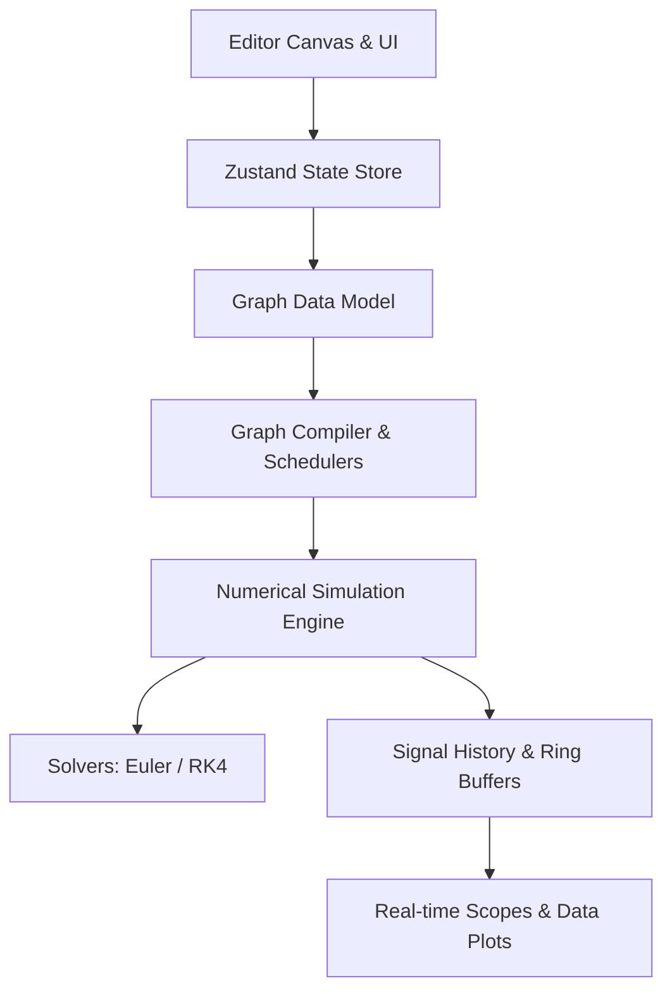

# Simulate

**Simulate** is a modern, web-based visual block-diagram modeling, dynamic systems simulation, and real-time signal analysis environment. Built with TypeScript, React, and Vite, it enables engineers, scientists, students, and researchers to design, simulate, and analyze continuous and discrete dynamic systems directly in the browser.

---

## Overview

Simulate provides a graphical environment where complex mathematical models and physical systems are constructed by connecting functional blocks. Signals propagate through directional wires between input and output ports, evaluated by an in-browser numerical simulation engine capable of solving differential equations, evaluating discrete-time filters, and rendering high-frequency oscilloscope waveforms.

### Key Capabilities

- **Visual Block-Diagram Modeling**: Intuitive drag-and-drop workspace powered by React Flow with grid snapping, multi-port routing, and interactive parameter configuration.
- **Dynamic Systems Simulation**: Time-stepping simulation engine supporting continuous-time differential equations and discrete-time recurrence relations.
- **Numerical Solvers**: Built-in support for fixed-step numerical integration algorithms, including Forward Euler and 4th-Order Runge-Kutta (RK4), with extensibility for variable-step solvers.
- **Virtual Instrumentation & Analysis**: Real-time oscilloscope scopes, XY phase-plane plots, digital value displays, and data logging.
- **Extensible Block Library**: Built-in mathematical operators, signal generators, non-linear functions, and continuous/discrete state blocks.
- **JSON Model Serialization**: Standardized schema for exporting, importing, versioning, and sharing complete simulation graphs and workspace states.

---

## Quick Start

### Prerequisites

- [Node.js](https://nodejs.org/) (v18.0.0 or higher recommended)
- `npm` (v8.0.0 or higher)

### Installation

Clone the repository and install dependencies:

```bash
# Clone the repository
git clone <repo-url>
cd Simulate

# Install dependencies (or run install.bat on Windows)
npm install
```

On Windows, you can double-click [`install.bat`](install.bat) to verify system prerequisites and run the install step automatically.

### Running the Development Server

Start the local Vite development server:

```bash
# Run dev server (or run serve.bat on Windows)
npm run dev
```

Open your browser and navigate to `http://localhost:5173`.

On Windows, you can also double-click [`serve.bat`](serve.bat).

### Available Scripts

- `npm run dev`: Starts the Vite development server with Hot Module Replacement (HMR).
- `npm run build`: Compiles TypeScript and packages the production bundle.
- `npm run preview`: Previews the production build locally.
- `npm run typecheck`: Runs TypeScript compiler (`tsc --noEmit`) to validate type safety.

---

## System Architecture



### Core Modules

1. **Canvas & UI ([`src/components/Editor.tsx`](file:///c:/Users/vxlee/OneDrive/Documents/Cursor/Simulate/src/components/Editor.tsx))**: Visual workspace managing block rendering, drag-and-drop placement, port connections, selection states, and canvas panning/zooming.
2. **State Store ([`src/store/index.ts`](file:///c:/Users/vxlee/OneDrive/Documents/Cursor/Simulate/src/store/index.ts))**: Centralized Zustand store holding active nodes, connection edges, parameters, execution states, and simulation clocks.
3. **Block Library ([`src/components/blocks/`](file:///c:/Users/vxlee/OneDrive/Documents/Cursor/Simulate/src/components/blocks/))**: Custom UI components and evaluation kernels for mathematical blocks (sources, operators, sinks, dynamic systems).
4. **Simulation Engine (Scheduled)**: Topological graph sorter, algebraic loop resolver, discrete/continuous time-stepper, and state integrator.
5. **Virtual Scopes & Instrumentation (Scheduled)**: High-performance canvas-based waveform visualizers with triggering, downsampling, and export features.

---

## Block Library Taxonomy

The platform organizes blocks into functional categories:

| Category | Typical Blocks | Purpose |
| :--- | :--- | :--- |
| **Sources** | Constant, Step, Sine Wave, Ramp, Pulse Generator, Clock | Inject independent driving signals into the model |
| **Sinks** | Time Scope, XY Plotter, Numeric Display, To CSV / File | Inspect, monitor, visualize, and record outputs |
| **Math Operations** | Gain, Sum (+/-), Product (*), Math Function (sin, cos, exp), Abs | Apply algebraic transformations to incoming signals |
| **Continuous** | Integrator (1/s), Derivative, Transfer Function, State-Space | Model differential equations and analog dynamic systems |
| **Discrete** | Unit Delay (1/z), Discrete Filter, Zero-Order Hold | Model sampled-data systems, digital control, and DSP |
| **Nonlinear / Routing** | Saturation, Dead Zone, Switch, Mux / Demux | Signal multiplexing, switching, and non-linear limits |

---

## Documentation

For full architectural blueprints, data schemas, mathematical formulations, and development guidelines, refer to the documentation:

- [System & Technical Specification](file:///c:/Users/vxlee/OneDrive/Documents/Cursor/Simulate/docs/SPECIFICATION.md): Comprehensive functional requirements, simulation mathematics, block contracts, and execution lifecycle.
- [Architecture & Engine Design](file:///c:/Users/vxlee/OneDrive/Documents/Cursor/Simulate/docs/ARCHITECTURE.md): Deep-dive into solver algorithms, topological sorting, signal bus protocols, and real-time visualization pipelines.

---

## Contributing & Roadmap

Refer to the [Phased Roadmap](file:///c:/Users/vxlee/OneDrive/Documents/Cursor/Simulate/docs/SPECIFICATION.md#9-implementation-roadmap) in the specification document for current priorities, including:

- Full continuous-state numerical engine (RK4 integration)
- Multi-channel Oscilloscope Scope block with canvas rendering
- Comprehensive core block library (Integrator, Sum, Sine, Scope, Gain, Transfer Function)
- Algebraic loop detection and visual error annotations
- Model save/load via standardized JSON schema

---

## License

Private repository. All rights reserved.
