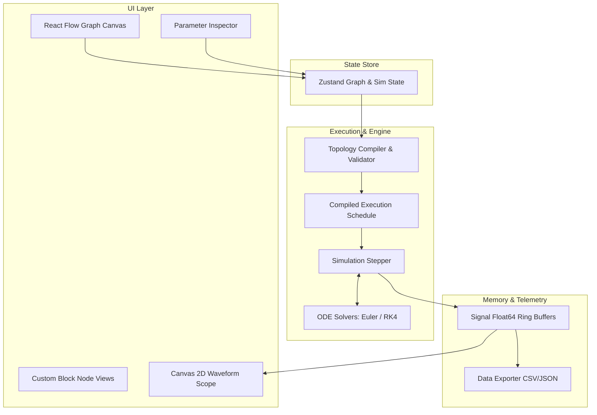

# Simulate: Architecture & Engine Design

This document details the software architecture, data structures, evaluation algorithms, and rendering pipelines underpinning the **Simulate** runtime environment.

---

## 1. High-Level Architectural Layers

Simulate is structured into four decoupled layers:



1. **Presentation & View**: React components managing block rendering, drag-and-drop mechanics, property editing, and canvas interactions.
2. **State Store**: Reactive Zustand store keeping nodes, edges, simulation parameters, and user preferences synchronized.
3. **Compiler & Scheduler**: Converts the visual graph into a compiled, high-performance execution plan; detects loops and assigns execution indices.
4. **Numerical Simulation Engine**: Evaluates block outputs and integrates continuous differential equations across discrete time increments.
5. **Memory & Signal Buffers**: Low-overhead typed array ring buffers for recording and streaming time-series data to visual instruments without triggering React render passes.

---

## 2. Core Data Structures & Interfaces

### 2.1 Block Definition & Runtime Instance

Each block type implements the `BlockDefinition` interface, separating static metadata/rendering from dynamic mathematical evaluation:

```typescript
export type SignalValue = number | number[]; // Scalar or vector

export interface PortDefinition {
  id: string;
  name: string;
  type: 'input' | 'output';
  dataType?: 'scalar' | 'vector';
  dimension?: number;
}

export interface BlockContext {
  t: number;            // Current simulation time (seconds)
  dt: number;           // Time step size (seconds)
  inputs: Record<string, SignalValue>;
  parameters: Record<string, any>;
  continuousState: Float64Array;
  discreteState: Float64Array;
}

export interface BlockDefinition {
  type: string;
  category: 'sources' | 'sinks' | 'math' | 'continuous' | 'discrete' | 'routing';
  name: string;
  description: string;
  
  // Port configuration
  inputs: PortDefinition[];
  outputs: PortDefinition[];
  
  // Execution characteristics
  hasDirectFeedthrough: boolean; // True if output depends directly on input at current step
  continuousStateCount: number;  // Dimension of continuous state vector
  discreteStateCount: number;    // Dimension of discrete state vector
  sampleTime: number;            // 0 = continuous, >0 = discrete sample interval
  
  // Default parameters
  defaultParameters: Record<string, any>;

  // Mathematical evaluation kernels
  computeOutputs: (ctx: BlockContext) => Record<string, SignalValue>;
  computeDerivatives?: (ctx: BlockContext) => Float64Array;
  updateDiscreteStates?: (ctx: BlockContext) => Float64Array;
}
```

### 2.2 Wire / Edge Connection

```typescript
export interface WireConnection {
  id: string;
  sourceBlockId: string;
  sourcePortId: string;
  targetBlockId: string;
  targetPortId: string;
}
```

---

## 3. Graph Compilation & Topological Scheduling

Before simulation starts, the **Topology Compiler** translates the user's visual block diagram into a linear execution schedule.

### 3.1 Dependency Resolution & Direct Feedthrough

Unlike simple flowcharts, dynamic systems have cyclic loops (feedback loops) that are physically valid if broken by a dynamic delay element (such as an Integrator or Unit Delay).

- A block has **direct feedthrough** if $y(t) = f(u(t), t)$. For example:
  - `Gain`: $y = k \cdot u$ (Direct feedthrough: **YES**)
  - `Sum`: $y = u_1 + u_2$ (Direct feedthrough: **YES**)
- An **Integrator** calculates output directly from state: $y(t) = x(t)$. The input $\dot{x}(t) = u(t)$ does *not* instantly affect $y(t)$ at the exact same instant (Direct feedthrough: **NO**).
- Therefore, feedback loops containing at least one Integrator ($1/s$) or Unit Delay ($1/z$) do **not** form algebraic loops.

### 3.2 Compilation Algorithm

```typescript
export function compileSchedule(
  blocks: BlockInstance[],
  wires: WireConnection[],
  blockDefs: Record<string, BlockDefinition>
): ExecutionPlan {
  // 1. Build adjacency list considering direct feedthrough dependencies
  const inDegree = new Map<string, number>();
  const graph = new Map<string, string[]>();

  for (const block of blocks) {
    inDegree.set(block.id, 0);
    graph.set(block.id, []);
  }

  for (const wire of wires) {
    const targetBlock = blocks.find(b => b.id === wire.targetBlockId);
    const targetDef = blockDefs[targetBlock.type];
    
    // An input dependency only constrains output order if the target has direct feedthrough
    if (targetDef.hasDirectFeedthrough) {
      graph.get(wire.sourceBlockId)!.push(wire.targetBlockId);
      inDegree.set(wire.targetBlockId, inDegree.get(wire.targetBlockId)! + 1);
    }
  }

  // 2. Kahn's Algorithm for Topological Sort
  const queue: string[] = [];
  inDegree.forEach((degree, id) => {
    if (degree === 0) queue.push(id);
  });

  const sortedOrder: string[] = [];
  while (queue.length > 0) {
    const current = queue.shift()!;
    sortedOrder.push(current);

    for (const neighbor of graph.get(current)!) {
      inDegree.set(neighbor, inDegree.get(neighbor)! - 1);
      if (inDegree.get(neighbor) === 0) {
        queue.push(neighbor);
      }
    }
  }

  // 3. Algebraic Loop Check
  if (sortedOrder.length !== blocks.length) {
    const cyclicBlocks = blocks
      .map(b => b.id)
      .filter(id => !sortedOrder.includes(id));
    throw new AlgebraicLoopError('Algebraic loop detected', cyclicBlocks);
  }

  return { sortedOrder };
}
```

---

## 4. Numerical Solver Architecture

The solver coordinates the continuous state vector $\mathbf{X} \in \mathbb{R}^N$, aggregating states from all continuous blocks (Integrators, Transfer Functions, State-Space systems).

### 4.1 State Vector Aggregation & Slicing

```
Global State Vector X(t):
+--------------------+--------------------+--------------------+
|  Integrator 1 (x0) |  Integrator 2 (x1) | Transfer Func (x2) |
+--------------------+--------------------+--------------------+
 0                    1                    2                    3
```

During initialization:
1. Each continuous block is assigned an offset and length within the global state vector $\mathbf{X}$.
2. The derivative function $\mathbf{F}(\mathbf{X}, t) = \dot{\mathbf{X}}$ evaluates block outputs and queries each continuous block's `computeDerivatives()` method.

### 4.2 RK4 (Runge-Kutta 4th Order) Implementation

```typescript
export class RK4Solver {
  step(
    system: SystemDynamics,
    t: number,
    h: number,
    X: Float64Array
  ): { tNext: number; xNext: Float64Array } {
    const n = X.length;
    const k1 = system.evalDerivatives(t, X);
    
    // Intermediate stage 1
    const xStage1 = new Float64Array(n);
    for (let i = 0; i < n; i++) xStage1[i] = X[i] + 0.5 * h * k1[i];
    const k2 = system.evalDerivatives(t + 0.5 * h, xStage1);

    // Intermediate stage 2
    const xStage2 = new Float64Array(n);
    for (let i = 0; i < n; i++) xStage2[i] = X[i] + 0.5 * h * k2[i];
    const k3 = system.evalDerivatives(t + 0.5 * h, xStage2);

    // Intermediate stage 3
    const xStage3 = new Float64Array(n);
    for (let i = 0; i < n; i++) xStage3[i] = X[i] + h * k3[i];
    const k4 = system.evalDerivatives(t + h, xStage3);

    // Final combination
    const xNext = new Float64Array(n);
    for (let i = 0; i < n; i++) {
      xNext[i] = X[i] + (h / 6.0) * (k1[i] + 2.0 * k2[i] + 2.0 * k3[i] + k4[i]);
    }

    return { tNext: t + h, xNext };
  }
}
```

---

## 5. High-Frequency Instrumentation & Ring Buffers

To guarantee 60 FPS performance without memory garbage collection pauses, time-series telemetry uses flat circular ring buffers:

```typescript
export class SignalRingBuffer {
  public time: Float64Array;
  public data: Float64Array;
  public head: number = 0;
  public count: number = 0;
  public readonly capacity: number;

  constructor(capacity: number = 10000) {
    this.capacity = capacity;
    this.time = new Float64Array(capacity);
    this.data = new Float64Array(capacity);
  }

  public push(t: number, value: number): void {
    this.time[this.head] = t;
    this.data[this.head] = value;
    this.head = (this.head + 1) % this.capacity;
    if (this.count < this.capacity) this.count++;
  }

  public clear(): void {
    this.head = 0;
    this.count = 0;
  }
}
```

### 5.1 Canvas 2D Oscilloscope Renderer

Waveforms are rendered directly to HTML5 `<canvas>` elements using requestAnimationFrame:
1. Calculates time window $[t - \Delta T_{\text{span}}, t]$.
2. Applies decimation/downsampling when the buffer size exceeds display horizontal pixel resolution ($W_{\text{px}}$).
3. Draws background gridlines, division labels, and traces using zero-allocation iterative coordinate transforms.

---

## 6. Block SDK: Authoring Custom Blocks

Developers can author new blocks by implementing standard hooks:

```typescript
export const CustomGainBlock: BlockDefinition = {
  type: 'gain',
  category: 'math',
  name: 'Gain',
  description: 'Multiplies input signal by a constant factor',
  inputs: [{ id: 'in', name: 'Input', type: 'input' }],
  outputs: [{ id: 'out', name: 'Output', type: 'output' }],
  hasDirectFeedthrough: true,
  continuousStateCount: 0,
  discreteStateCount: 0,
  sampleTime: 0,
  defaultParameters: { k: 1.0 },

  computeOutputs: (ctx) => {
    const u = (ctx.inputs['in'] ?? 0) as number;
    const k = (ctx.parameters['k'] ?? 1.0) as number;
    return { out: k * u };
  },
};
```
