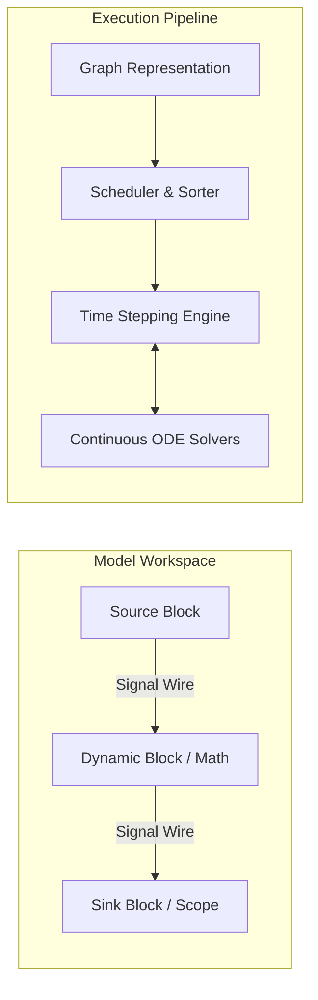
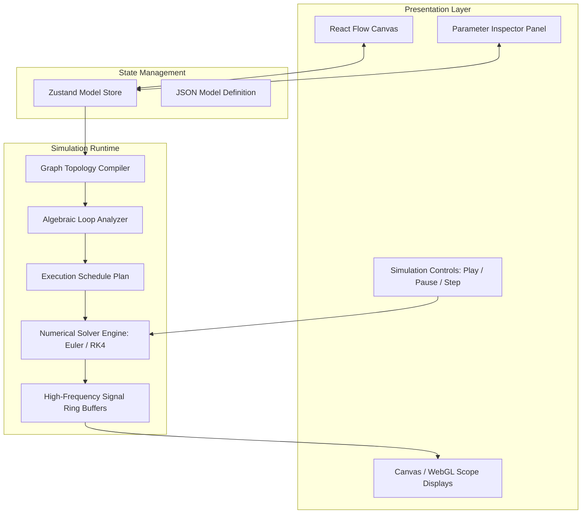
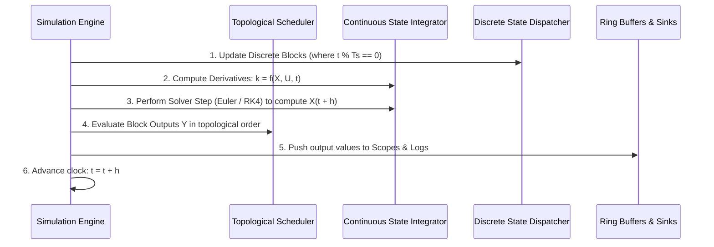

# Simulate: System & Technical Specification

## 1. Executive Summary & Vision

**Simulate** is a browser-native visual dynamic systems modeling, simulation, and analysis platform. It provides a visual block-diagram programming interface coupled to a deterministic numerical simulation engine. Users can build mathematical models, control systems, dynamic physical analogies, and signal processing chains by connecting modular functional blocks with directional signal wires, executing simulations in continuous and discrete time, and visualizing system trajectories using real-time virtual instrumentation (scopes, XY plotters, and digital meters).

### 1.1 Core Principles
- **Visual Block-Diagram Semantics**: Nodes represent mathematical operations, signal sources, dynamic state integrators, or visualization sinks. Edges represent directed signal flow.
- **Strict Mathematical Determinism**: Given identical initial conditions, inputs, and solver configurations, simulations yield reproducible numerical trajectories.
- **Continuous and Discrete Time Domains**: Support for continuous-time ordinary differential equations (ODEs), discrete-time difference equations, and hybrid multi-rate systems.
- **Low-Latency In-Browser Execution**: Highly optimized numerical evaluation loops capable of 1 kHz+ simulation step rates with smooth 60 FPS oscilloscope rendering.
- **Extensible Architecture**: Clean abstraction layers separating graph representation, schedule compilation, numerical solvers, and view components.

---

## 2. Conceptual Model & Terminology



| Term | Definition |
| :--- | :--- |
| **Block (Node)** | An autonomous computational element with input ports, output ports, internal state vectors, and user-configurable parameters. |
| **Port** | A typed interface point on a block. Input ports consume incoming signals; output ports produce computed signals. |
| **Signal (Wire / Edge)** | A directed data channel propagating numerical values (scalars or vectors) from one output port to one or more input ports. |
| **Continuous State ($x_c$)** | Internal memory variables governed by differential equations $\dot{x}_c = f(x_c, u, t)$, integrated across time steps. |
| **Discrete State ($x_d$)** | Internal memory variables updated at discrete clock intervals: $x_d[k+1] = f_d(x_d[k], u[k], t_k)$. |
| **Direct Feedthrough** | A property indicating that a block's output $y(t)$ explicitly depends on its current input $u(t)$ at the same time instant ($y = g(u, t)$). Blocks without direct feedthrough (e.g. Integrator: $y = x_c$) break algebraic dependencies. |
| **Algebraic Loop** | A closed loop of blocks where every block in the cycle has direct feedthrough, creating an implicit equation $u = g(u)$ that cannot be solved by direct topological ordering. |
| **Sample Time ($T_s$)** | The time interval between successive block executions. Continuous blocks operate at $T_s = 0$; discrete blocks operate at specified intervals $T_s > 0$. |

---

## 3. System Architecture & Data Flow



### 3.1 Component Hierarchy
1. **Model Canvas ([`src/components/Editor.tsx`](file:///c:/Users/vxlee/OneDrive/Documents/Cursor/Simulate/src/components/Editor.tsx))**:
   - Manages block layout, wire routing, port connection rules, panning, zooming, and selection.
   - Integrates with node-specific renderers for dynamic visual feedback.
2. **Model Store ([`src/store/index.ts`](file:///c:/Users/vxlee/OneDrive/Documents/Cursor/Simulate/src/store/index.ts))**:
   - Manages reactive state for blocks (`id`, `type`, `position`, `parameters`, `state`), connections (`id`, `source`, `sourceHandle`, `target`, `targetHandle`), simulation clock (`t`, `tStop`, `dt`, `status`).
3. **Graph Topology Compiler**:
   - Validates connection integrity (no dangling required inputs, compatible signal types).
   - Analyzes feedthrough flags to construct the Directed Acyclic Graph (DAG) for evaluation.
   - Detects and flags algebraic loops with visual edge highlights.
4. **Numerical Simulation Engine**:
   - Coordinates continuous state updates, discrete state clock events, and block evaluation sequences.
   - Implements fixed-step Forward Euler, Heun (RK2), and Runge-Kutta 4th Order (RK4) solvers.
5. **Ring Buffer Storage & Scope Sinks**:
   - Stores time-stamped signal trajectories in fixed-capacity pre-allocated TypedArrays (`Float64Array`).
   - Renders oscilloscope waveforms independently from React render cycles via HTML5 Canvas 2D or WebGL.

---

## 4. Block Library Specification

### 4.1 Sources (Signal Generators)

| Block Type | Parameters | Mathematical Formulation | Direct Feedthrough |
| :--- | :--- | :--- | :--- |
| **Constant** | `value` (real) | $y(t) = \text{value}$ | No |
| **Step** | `stepTime` ($t_0$), `initialValue` ($y_0$), `finalValue` ($y_1$) | $y(t) = y_0 \text{ for } t < t_0; \quad y_1 \text{ for } t \ge t_0$ | No |
| **Sine Wave** | `amplitude` ($A$), `frequency` ($\omega$), `phase` ($\phi$), `bias` ($B$) | $y(t) = A \sin(\omega t + \phi) + B$ | No |
| **Ramp** | `slope` ($m$), `startTime` ($t_0$), `initialOutput` ($y_0$) | $y(t) = y_0 \text{ for } t < t_0; \quad y_0 + m(t - t_0) \text{ for } t \ge t_0$ | No |
| **Pulse Generator** | `period` ($T$), `pulseWidth` (%), `amplitude` ($A$), `phaseDelay` ($t_d$) | Periodic rectangular pulse train | No |
| **Clock** | (none) | $y(t) = t$ (current simulation time) | No |
| **Random Noise** | `mean`, `variance`, `seed`, `sampleTime` | Uniform or Gaussian random distribution updated at sample intervals | No |

---

### 4.2 Mathematical Operators

| Block Type | Ports | Parameters | Mathematical Formulation | Direct Feedthrough |
| :--- | :--- | :--- | :--- | :--- |
| **Gain** | 1 in, 1 out | `k` (real or vector) | $y(t) = k \cdot u(t)$ | Yes |
| **Sum** | $N$ in, 1 out | `signs` (e.g. `++`, `+-`, `+-+`) | $y(t) = \sum_{i=1}^N \text{sign}_i \cdot u_i(t)$ | Yes |
| **Product** | $N$ in, 1 out | `operators` (`*`, `/`) | $y(t) = \prod_{i=1}^N u_i(t)^{\text{op}_i}$ | Yes |
| **Math Function** | 1 in, 1 out | `function` (`sin`, `cos`, `tan`, `exp`, `ln`, `abs`, `sqrt`, `square`) | $y(t) = f(u(t))$ | Yes |
| **Min / Max** | $N$ in, 1 out | `mode` (`min`, `max`) | $y(t) = \min(u_1, \dots, u_N)$ or $\max(u_1, \dots, u_N)$ | Yes |
| **Bias** | 1 in, 1 out | `bias` ($B$) | $y(t) = u(t) + B$ | Yes |

---

### 4.3 Continuous Dynamic State Blocks

Continuous blocks encapsulate differential equations and require numerical integration across simulation steps.

#### 4.3.1 Integrator ($1/s$)
- **Ports**: 1 input ($u$), 1 output ($y$). Optional reset port ($rst$) and external initial condition port ($x_0$).
- **Parameters**:
  - `initialCondition` ($y_0$): Initial state value at $t = 0$.
  - `limitOutput` (bool): Enable output saturation limits.
  - `upperLimit` ($y_{max}$), `lowerLimit` ($y_{min}$): Saturation bounds.
- **Dynamics**:
  $$\dot{x}(t) = u(t), \quad y(t) = x(t)$$
  $$\text{With saturation: } y(t) = \text{clamp}(x(t), y_{min}, y_{max})$$
- **Feedthrough**: **No direct feedthrough** ($y(t)$ depends solely on internal state $x(t)$, which breaks algebraic loops).

#### 4.3.2 Derivative
- **Ports**: 1 input ($u$), 1 output ($y$).
- **Parameters**: `timeConstant` ($\tau$).
- **Formulation** (band-limited derivative for numerical stability):
  $$y(s) = \frac{s}{\tau s + 1} u(s) \implies \dot{x} = -\frac{1}{\tau} x + \frac{1}{\tau} u, \quad y = \frac{1}{\tau}(u - x)$$

#### 4.3.3 Linear Transfer Function ($H(s)$)
- **Ports**: 1 input ($u$), 1 output ($y$).
- **Parameters**:
  - `numerator`: Array of polynomial coefficients $[b_m, b_{m-1}, \dots, b_0]$
  - `denominator`: Array of polynomial coefficients $[a_n, a_{n-1}, \dots, a_0]$ with $n \ge m$
- **Formulation**:
  $$H(s) = \frac{Y(s)}{U(s)} = \frac{b_m s^m + b_{m-1} s^{m-1} + \dots + b_0}{a_n s^n + a_{n-1} s^{n-1} + \dots + a_0}$$
- **State-Space Conversion**: Internally transformed into Controllable Canonical Form:
  $$\dot{x} = A x + B u, \quad y = C x + D u$$
  *(If $n > m$, then $D = 0$ and the block has no direct feedthrough).*

#### 4.3.4 State-Space System
- **Ports**: $m$ inputs ($u$), $p$ outputs ($y$).
- **Parameters**: Matrices $A \in \mathbb{R}^{n \times n}$, $B \in \mathbb{R}^{n \times m}$, $C \in \mathbb{R}^{p \times n}$, $D \in \mathbb{R}^{p \times m}$, initial state vector $x_0 \in \mathbb{R}^n$.
- **Dynamics**:
  $$\dot{x}(t) = A x(t) + B u(t)$$
  $$y(t) = C x(t) + D u(t)$$
  *(Has direct feedthrough only if $D \ne 0$).*

---

### 4.4 Discrete Dynamic Blocks

| Block Type | Parameters | Difference Equation | Description |
| :--- | :--- | :--- | :--- |
| **Unit Delay ($z^{-1}$)** | `sampleTime` ($T_s$), `initialOutput` ($y_0$) | $y[k] = x_d[k], \quad x_d[k+1] = u[k]$ | Delays signal by one sample period. Breaks discrete algebraic loops. |
| **Zero-Order Hold (ZOH)** | `sampleTime` ($T_s$) | $y(t) = u(k T_s) \text{ for } k T_s \le t < (k+1)T_s$ | Converts continuous signals into discrete piecewise-constant signals. |
| **Discrete Filter ($H(z)$)** | `numerator`, `denominator`, `sampleTime` | Direct Form II Transposed realization | Discrete IIR/FIR filter implementation. |

---

### 4.5 Nonlinear & Routing Blocks

| Block Type | Parameters | Logic / Formulation | Direct Feedthrough |
| :--- | :--- | :--- | :--- |
| **Saturation** | `upperLimit`, `lowerLimit` | $y = \text{min}(\text{upper}, \text{max}(\text{lower}, u))$ | Yes |
| **Dead Zone** | `startValue`, `endValue` | Suppresses signal when inside specified dead band | Yes |
| **Switch** | `threshold`, `criteria` (`>=`, `>`) | $y = u_1 \text{ if } u_2 \ge \text{threshold} \text{ else } u_3$ | Yes |
| **Multiplexer (Mux)** | `numInputs` | Aggregates multiple scalar signals into a vector signal | Yes |
| **Demultiplexer (Demux)** | `numOutputs` | Splits a vector signal into separate scalar outputs | Yes |

---

### 4.6 Sinks & Instrumentation

| Block Type | Functionality | Visualization Features |
| :--- | :--- | :--- |
| **Oscilloscope (Scope)** | Real-time time-domain plot $y(t)$ vs. $t$ | Multi-signal traces, auto-ranging, time-base zoom, pan, edge triggers, CSV data export. |
| **XY Graph** | Phase-plane trajectory plotting $u_y(t)$ vs. $u_x(t)$ | Orbit inspection, limit cycle analysis, parametric curves. |
| **Numeric Display** | Real-time numeric readout of instantaneous value | Configurable decimal precision, scientific notation option. |
| **To Workspace / File** | Logs complete simulation time series to memory | Downloadable as JSON or CSV formatted dataset. |

---

## 5. Simulation Execution Engine & Solver Mathematics

### 5.1 Simulation Loop Architecture

The simulation runs in discrete time-steps of length $h = \Delta t$. At each time step $t_n = n \cdot h$:



### 5.2 Numerical Solvers

#### 5.2.1 Forward Euler Solver (1st Order)
- Simplest and fastest solver, suitable for non-stiff systems with small step sizes.
- Formulation:
  $$X_{n+1} = X_n + h \cdot \dot{X}_n$$
  $$\dot{X}_n = f(X_n, U_n, t_n)$$

#### 5.2.2 4th-Order Runge-Kutta Solver (RK4)
- High-accuracy standard solver for continuous dynamic systems.
- Formulation:
  $$k_1 = f(X_n, U_n, t_n)$$
  $$k_2 = f\left(X_n + \frac{h}{2} k_1, U\left(t_n + \frac{h}{2}\right), t_n + \frac{h}{2}\right)$$
  $$k_3 = f\left(X_n + \frac{h}{2} k_2, U\left(t_n + \frac{h}{2}\right), t_n + \frac{h}{2}\right)$$
  $$k_4 = f(X_n + h k_3, U(t_n + h), t_n + h)$$
  $$X_{n+1} = X_n + \frac{h}{6} (k_1 + 2k_2 + 2k_3 + k_4)$$

### 5.3 Graph Sorting & Algebraic Loop Resolution
1. **Dependency Graph Construction**: Construct directed graph where edge $A \to B$ exists if Block $A$'s output connects to Block $B$'s input.
2. **Direct Feedthrough Filtering**: In calculating calculation dependencies, only blocks with direct feedthrough ($y = g(u)$) introduce immediate execution constraints.
3. **Topological Sort**: Kahn's algorithm yields an ordered array `executionOrder: Block[]`.
4. **Loop Detection**:
   - If an unbroken cycle of direct-feedthrough blocks is encountered (e.g. $A \to B \to A$), Kahn's algorithm terminates with unvisited nodes.
   - The engine reports an **Algebraic Loop Error**, highlighting the implicated nodes and suggesting the insertion of an Integrator ($1/s$) or Unit Delay ($1/z$).

---

## 6. Real-Time Oscilloscope & Visualization Engine

### 6.1 Performance Strategy
- **Decoupled Render Loop**: Simulation calculation runs at the solver frequency (e.g., $1000\text{ Hz}$ or $h = 0.001\text{ s}$), while visualization renders at browser display refresh rate ($\sim 60\text{ FPS}$) via `requestAnimationFrame`.
- **Pre-allocated Circular Ring Buffers**:
  ```typescript
  interface SignalBuffer {
    time: Float64Array;
    values: Float64Array;
    head: number;
    capacity: number;
    size: number;
  }
  ```
- **Direct HTML5 2D Canvas / WebGL Pathing**: Avoids React component re-rendering overhead on high-frequency data streams.

### 6.2 Scope Features
- **Multi-channel Overlay**: Support for up to 8 distinct signal traces per scope with individual colors and legends.
- **Interactive Controls**:
  - Horizontal Time Base (seconds/div) & Vertical Scale (volts or units/div).
  - Auto-scale button to fit waveform dynamically.
  - Triggering modes: Auto, Normal, Single-shot (Rising/Falling edge threshold).
  - Snapshot export: PNG image or CSV time series.

---

## 7. Model Schema & Serialization Format

The entire simulation diagram serializes to a clean, declarative JSON schema:

```json
{
  "version": "1.0.0",
  "metadata": {
    "name": "Second Order RLC System",
    "author": "Engineer",
    "description": "Step response of an underdamped second-order continuous system",
    "created": "2026-10-04T18:00:00Z"
  },
  "simulationConfig": {
    "solver": "rk4",
    "startTime": 0.0,
    "stopTime": 10.0,
    "stepSize": 0.001,
    "realTimePacing": true
  },
  "nodes": [
    {
      "id": "step-1",
      "type": "step",
      "position": { "x": 100, "y": 200 },
      "parameters": {
        "stepTime": 1.0,
        "initialValue": 0.0,
        "finalValue": 1.0
      }
    },
    {
      "id": "sum-1",
      "type": "sum",
      "position": { "x": 260, "y": 200 },
      "parameters": {
        "signs": "+-"
      }
    },
    {
      "id": "integrator-1",
      "type": "integrator",
      "position": { "x": 420, "y": 200 },
      "parameters": {
        "initialCondition": 0.0,
        "limitOutput": false
      }
    },
    {
      "id": "scope-1",
      "type": "scope",
      "position": { "x": 620, "y": 200 },
      "parameters": {
        "timeSpan": 10.0,
        "yMin": -0.5,
        "yMax": 2.0
      }
    }
  ],
  "edges": [
    {
      "id": "edge-1",
      "source": "step-1",
      "sourceHandle": "out",
      "target": "sum-1",
      "targetHandle": "in1"
    },
    {
      "id": "edge-2",
      "source": "sum-1",
      "sourceHandle": "out",
      "target": "integrator-1",
      "targetHandle": "in"
    },
    {
      "id": "edge-3",
      "source": "integrator-1",
      "sourceHandle": "out",
      "target": "scope-1",
      "targetHandle": "in"
    }
  ]
}
```

---

## 8. User Interface & Workflow Design

```
+-----------------------------------------------------------------------------------------+
| [Simulate]  File  Edit  Simulation  Help          [▶ Run] [⏸ Pause] [⏹ Stop] [⚙ Config] |
+-----------------------+-------------------------------------------------+---------------+
| Block Library         | Model Workspace (React Flow Canvas)             | Inspector     |
| --------------------- | ----------------------------------------------- | ------------- |
| > Sources             |                                                 | Selected:     |
|   - Step              |    [Step] ---> (+) ---> [1/s] ---> [Scope]      | Integrator-1  |
|   - Sine Wave         |                 ^          |                    |               |
|   - Constant          |                 |          v                    | Initial Cond: |
| > Continuous          |                 +--[Gain]<-+                    | [ 0.0       ] |
|   - Integrator (1/s)  |                                                 | Limits:       |
|   - Transfer Function |                                                 | [ ] Enabled   |
| > Math Operations     |                                                 |               |
|   - Gain              |                                                 | Upper Limit:  |
|   - Sum               |                                                 | [ 10.0      ] |
| > Sinks               |                                                 |               |
|   - Scope             |                                                 | Lower Limit:  |
|   - Numeric Display   |                                                 | [ -10.0     ] |
+-----------------------+-------------------------------------------------+---------------+
| Status: Ready | t = 2.450s / 10.000s | Step: 1ms | Solver: RK4 | Mode: Real-time (1.0x) |
+-----------------------------------------------------------------------------------------+
```

### 8.1 Key UX Interactions
- **Palette Drag-and-Drop**: Users drag blocks from the left sidebar palette directly onto the grid canvas.
- **Smart Wire Drawing**: Clicking an output port and dragging to an input port connects the signal wire with orthogonal bezier or stepped routing.
- **Double-Click Parameter Inspector**: Double-clicking any block opens its parameter configuration dialog or reveals properties in the side panel.
- **Integrated Scope Windows**: Scope blocks can render mini-thumbnails on canvas or expand into full-featured floating windows or bottom docked docks.

---

## 9. Implementation Roadmap

### Phase 1: Core Simulation Engine & Primitives
- [x] React Flow canvas foundation and initial Gain block.
- [ ] Centralized Simulation Store (`simulationTime`, `status`, `solverType`, `stepSize`).
- [ ] Graph compiler: dependency analysis, topological sort, direct feedthrough tracking.
- [ ] Solvers: Fixed-step Forward Euler and RK4 engine.
- [ ] Essential blocks:
  - Source: Constant, Step, Sine Wave.
  - Math: Gain, Sum (+/-), Product.
  - Continuous: Integrator ($1/s$).
  - Sink: Basic numeric display and single-trace canvas oscilloscope.

### Phase 2: Enhanced Modeling & Instrumentation
- [ ] Multi-channel Oscilloscope with zooming, panning, and triggers.
- [ ] Continuous dynamic blocks: Transfer Function ($H(s)$) and Derivative.
- [ ] Discrete dynamic blocks: Unit Delay ($1/z$) and Zero-Order Hold.
- [ ] Algebraic loop detection with visual error notification.
- [ ] Parameter configuration modal & dockable property inspector.

### Phase 3: Advanced Systems & Persistence
- [ ] State-Space ($A, B, C, D$) continuous block.
- [ ] Nonlinear blocks: Saturation, Dead Zone, Switch.
- [ ] Signal vectorization: Mux / Demux.
- [ ] Model persistence: Save / Load model files (.json) with pre-built example templates (PID controller, Harmonic oscillator, Mass-Spring-Damper).
- [ ] High-speed Web Worker simulation thread for non-blocking computation.
